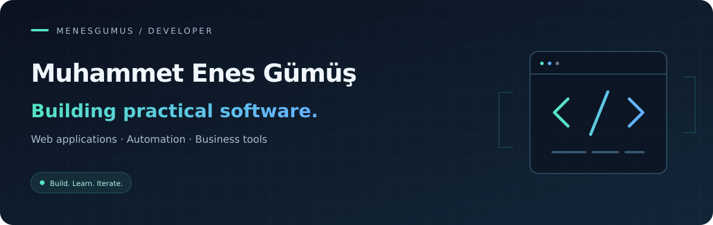

  

  <strong>Computer Engineering Student · Full-Stack Development · Automation</strong>

  I build web applications and tools that turn everyday problems into useful software. 
  My work spans business platforms, personal productivity and security tooling.

  <a href="#selected-projects">Selected projects</a> &nbsp; / &nbsp;
  <a href="#toolbox">Toolbox</a> &nbsp; / &nbsp;
  <a href="https://github.com/Menesgumus?tab=repositories">Explore repositories</a>

---

### A little about me

- 🎓 Studying Computer Engineering at Harran University.
- 🛠️ Building responsive interfaces, backend services and practical automation tools.
- 🧩 Interested in the full journey: understanding a problem, building a solution and deploying it.
- 🌱 Exploring cybersecurity and industrial systems alongside web development.

### Selected projects

<table>
  <tr>
    <td width="50%" valign="top">
      <h3>01 / Ankara Pet House</h3>
      
A pet hospitality platform with a public website and an admin panel for services, accommodation and content.

      
Next.js · Spring Boot · PostgreSQL · Docker

      <a href="https://github.com/Menesgumus/PetOtel">Explore project →</a>
    </td>
    <td width="50%" valign="top">
      <h3>02 / Kariyer Rotam</h3>
      
A focused application tracker that helps students and new graduates organize their job search and follow application stages.

      
React · TypeScript · Vite · localStorage

      <a href="https://github.com/Menesgumus/kariyer-rotam">Explore project →</a>
    </td>
  </tr>
  <tr>
    <td width="50%" valign="top">
      <h3>03 / ALTAY Log Analyzer</h3>
      
A log analysis and live monitoring tool with configurable rules, operator alerts and CSV reports.

      
Python · YAML · Docker · Log Analysis

      <a href="https://github.com/Menesgumus/ALTAY-Log-Analyzer">Explore project →</a>
    </td>
    <td width="50%" valign="top">
      <h3>04 / Karanfil Vet</h3>
      
A custom WordPress theme for a veterinary clinic, with manageable content and accessible navigation.

      
WordPress · Theme Development · JavaScript

      <a href="https://github.com/Menesgumus/KaranfilvetTema">Explore project →</a>
    </td>
  </tr>
</table>

### Toolbox

| Area | Technologies I work with |
| :--- | :--- |
| Frontend | React · Next.js · TypeScript · Tailwind CSS |
| Backend & data | Java · Spring Boot · PostgreSQL |
| Automation & tooling | Python · Git · Docker |
| Deployment | Docker Compose · Nginx · Cloudflare |

---

  Useful software. Thoughtful interfaces. Always learning.

